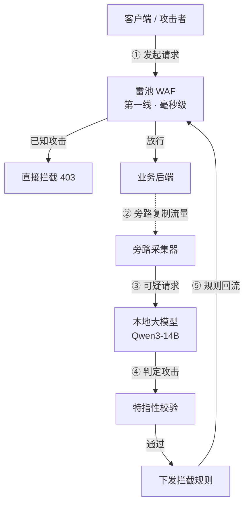
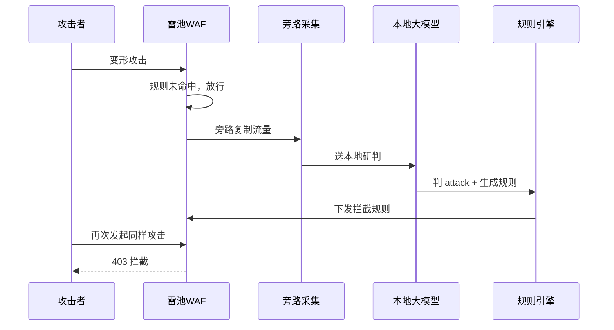
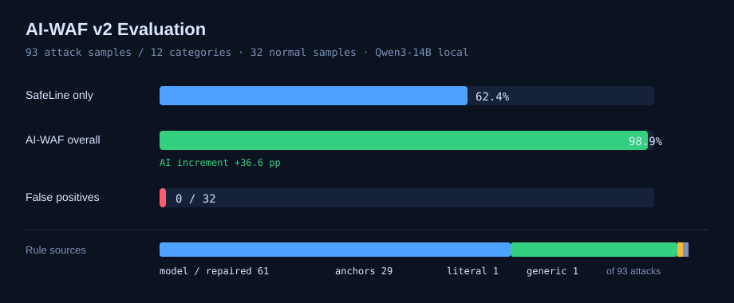

# AI-WAF 智能 Web 应用防火墙

[](https://github.com/JensonLi-ai/ai-WAF/actions/workflows/ci.yml)
[](LICENSE)
[](https://www.python.org/)
[](https://github.com/QwenLM/Qwen3)
[](https://waf.chaitin.cn/)
[](https://ifdian.net/a/Jenson-li)

> 🔒 **数据不出网**：流量从采集、研判到拦截，全程留在你自己的服务器，不交给任何云端。
>
> 💰 **中小企业也用得起**：开源组件 + 本地模型搭建，一次硬件投入，告别商业 WAF 每年几万块的订阅费。

一个把「本地大模型」接入开源 WAF 的**闭环防护系统**——不仅拦截已知攻击，还能**自动发现并补上规则没见过的变形攻击**。

> ⚠️ 本项目仅供合法的授权安全测试与学习研究使用。请勿用于任何未授权的攻击行为。

### English Summary

AI-WAF is a closed-loop Web Application Firewall that puts a **local LLM** (Qwen3-14B) behind SafeLine:

- **On-prem by design** — traffic and payloads never leave your server.
- **Two-stage defense** — SafeLine blocks known signatures in milliseconds; the LLM reviews only bypass traffic asynchronously.
- **Self-healing rules** — the model extracts verbatim attack anchors from payloads, the engine assembles and validates regexes, rules enter an observation period, are replayed against normal traffic, then promoted automatically.
- **Fail-closed safety** — insufficient replay pool means *no promotion*; polluted normal-pool entries are re-checked by the LLM and quarantined; panel APIs require a token and JSON-only POSTs.
- **Measured, not claimed** — `93` attack samples across `12` categories + `32` false-positive traps. SafeLine-only recall **62%**, AI adds **+36.6 pp** for **99%** overall, **0/32** false positives. Raw run: [`docs/eval-v2.json`](docs/eval-v2.json).

---

## 📖 目录

- [核心特性](#核心特性)
- [架构](#架构)
- [工作原理](#工作原理)
- [检测能力](#检测能力)
- [防误杀机制](#防误杀机制)
- [规则生命周期](#规则生命周期)
- [目录结构](#目录结构)
- [环境要求](#环境要求)
- [项目就绪度](#项目就绪度)
- [评测基准](#评测基准)
- [运行模式](#运行模式)
- [快速开始](#快速开始)
- [技术栈](#技术栈)
- [支持 / 赞助](#支持--赞助)

---

## 核心特性

- **本地化 / 数据不出网**：本地大模型离线推理，攻击流量与 payload 零外发，天然满足数据本地化要求
- **自动补漏（漏判检测闭环）**：旁路复盘被放行的流量，AI 认出新型攻击后自动生成拦截规则回流到 WAF
- **双层防护**：第一线雷池 WAF 毫秒级拦截已知攻击，第二层 AI 大脑异步发现漏判
- **两道防误杀保险**：规则下发前做「特指性校验」，转正前做「正常流量回放」，宁可漏判、不可误杀
- **规则全生命周期管理**：观察期 → 转正拦截 → 回收，全自动
- **可观测**：内置 Web 面板 + 终端 `trace` 工具，单步观察一次攻击从进入到被拦截的完整过程

## 架构

```
客户端/攻击者 ──①──> 雷池 WAF（第一线 · 毫秒级）
                       │ 已知攻击 ──> 403 拦截
                       │ 放行 ──> 业务后端
                                     │ ② 旁路复制流量
旁路采集器 <──────────────────────────┘
   │ ③ 可疑请求
本地大模型 Qwen3-14B
   │ ④ 判定为攻击
特指性校验（防误杀）
   │ 通过
下发拦截规则 ──⑤──> 雷池 WAF（规则回流）
```



## 工作原理

一次变形攻击（OGNL 表达式注入 `#{7*7}`，Struts2 框架经典漏洞）的完整处理过程：



关键点：**它不怕第一枪**。第一波攻击可能漏过去，但 AI 会立刻补上规则，攻击者只能打一发，后续同样的手法全部被封死。

## 检测能力

| 攻击类别 | 典型特征 |
|---|---|
| SQL 注入 | `union select`、`sleep()` 时间盲注、`information_schema` |
| XSS 跨站脚本 | `<script>`、`<svg onload>`、`javascript:` |
| 命令注入 | `\|id`、`;whoami`、`$(...)` |
| 路径穿越 | `../../etc/passwd` |
| SSRF | `169.254.169.254` 云元数据地址 |
| SSTI 模板注入 | `${...}`、`#{...}`、`{{...}}` |
| XXE / XML 注入 | `<!DOCTYPE>`、`<!ENTITY>` |
| 反序列化 | `O:8:"..."` PHP 序列化对象 |

## 防误杀机制

AI 自动生成规则最大的风险是生成"过宽泛"的规则误杀正常业务，因此内置两道保险：

1. **特指性校验**：规则下发前检查是否足够具体。像 `\bsleep\s*\(` 这种会命中"任何含 sleep 的请求"的过泛规则，直接拒绝下发。
2. **转正前回放**：规则从"观察"转"拦截"前，拿历史正常流量池回放一遍，命中任何正常请求即拒绝转正。

## 安全加固

除防误杀外，系统本身也按"不可信输入"设计：

- **回放 fail-closed**：正常流量池样本数不足 `NORMAL_POOL_MIN` 时，规则**不转正**（保持观察期），而不是直接放行。
- **正常池抗污染**：回放命中项先交 LLM 复核；判定为攻击的条目立即从正常池隔离，防止攻击者用污染样本压制规则。LLM 出错时保守拒绝转正。
- **提示词注入防护**：payload 被包裹在 `<untrusted_event>` 标签内并声明为不可信数据；同时有确定性检测（`ignore previous instructions`、`忽略指令`、`system prompt` 等），命中直接按攻击处理，不依赖模型是否被说服。
- **面板鉴权 / CSRF**：`WEB_AUTH_TOKEN` 设置后所有 `/api/*`（除健康检查）需 `X-Auth-Token`；POST 校验同源 `Origin` 且强制 `application/json`，阻断表单型 CSRF。未设置令牌时仅允许绑定回环地址，绑非回环直接拒绝启动。
- **规则安全**：拒绝嵌套量词 ReDoS 结构；字面规则截断后必须可编译；规则合并前重新回放；`(?i)` 等内联标志转作用域形式，避免拼接后编译失败。
- **候选不丢**：单轮超出 `MISS_MAX_BATCH` 的漏判候选进入 backlog，下一轮继续处理。

## 规则生命周期

```
观察期（默认 7 天，可配 OBSERVE_TTL_HOURS）─→ 命中达标 + 零误杀回放通过 ─→ 转正拦截
        │                                          │
        └────── 到期未达标 ──> 回收 <── 长期零命中 ──┘
```

## 目录结构

```
aiwaf/
├── main.py           # 入口：启动引擎线程 + Web 面板
├── engine.py         # 闭环引擎：轮询、研判、规则生成与生命周期维护
├── llm_client.py     # 本地 LLM 客户端（OpenAI 兼容接口 + JSON grammar）
├── safeline_api.py   # 雷池控制台 API 客户端
├── miss_collector.py # 旁路采集器（记录放行流量）
├── trace.py          # 链路追踪工具（单步观察拦截过程）
├── web.py            # Web 面板（无外部依赖的单页应用）
├── db.py             # SQLite 存储 + 规则生命周期数据层
├── benchmark.py      # AI 研判层离线评测（检出/误报/规则质量）
└── config.py         # 全局配置（环境变量可覆盖）
corpus/external/      # 外部攻击语料（SecLists + PayloadsAllTheThings）
tools/                # 语料构建脚本
start_llm.bat          # 启动本地大模型 llama-server
start_collector_wsl.sh # 启动旁路采集器（WSL 内）
start_engine.bat       # 启动闭环引擎 + Web 面板
start_keepalive.bat    # 进程保活
AI-WAF一键恢复.bat      # 一键拉起全部组件
verify_miss_loop.py   # 漏判闭环回归脚本
miss_traffic_test.jsonl  # 测试样本
loadtest.py           # 旁路采集器压测（QPS / 延迟分位）
Dockerfile            # 引擎容器镜像
docker-compose.yml    # 容器化部署（数据卷 + 健康检查）
tests/test_engine.py  # 核心安全逻辑单元测试
```

## 环境要求

- **生产推荐：Linux + Docker**（雷池官方支持的环境）
- 开发验证：Windows 10/11 + **WSL2** + Docker（本项目开发环境）
- **NVIDIA 独立显卡**（建议 16GB 显存，如 RTX 5060 Ti；低配可换 4B/1.7B 模型）
- Python 3.10+（引擎侧纯标准库，无需 pip 安装额外依赖）

## 项目就绪度

> 当前为**验证原型**：核心闭环已在单卡 16G 显存环境下完整跑通，但尚未经过真实生产流量考验，**不建议直接用于生产环境**。

- 已跑通：漏判检测闭环、AI 规则自动生成、特指性校验、转正前正常流量回放（E2E 回归见 `verify_miss_loop.py`）
- 进行中：真实流量压测、大规模 CVE 语料的基座模型领域微调、与商业 WAF 的横向检出率 / 误报率对比

已知限制：
- 存储为单文件 SQLite，引擎 / 采集器 / Web 面板多进程并发读写依赖 busy_timeout 串行化，适合原型与中小流量；高并发生产需换 Postgres。
- 正常流量回放池靠粗筛过滤疑似攻击，仍存在极低概率被「粗筛与 LLM 均漏判」的变形攻击污染、进而延迟某条规则转正的可能，属已知边界（回放命中项 LLM 复核已列入后续计划）。

> 本项目下一步目标：在更大算力上完成基座模型的领域微调与攻防对抗评测，达到生产级检出与误报指标后，再发布生产部署建议。

## 评测基准

内置离线评测 `python -m aiwaf.benchmark`，量化 AI 研判层（第二层）的能力。当前语料 **v2**：93 条变形攻击样本（12 类，含 SQLi/XSS/CMDi/穿越/SSRF/SSTI/XXE/反序列化/NoSQL/CRLF/LDAP/JNDI）+ 32 条「易误判」正常样本，持续扩充中。

评测同时模拟**雷池第一线**（内置常见签名规则）：先判哪些样本会被第一线直接拦截，只把漏判样本算作"送 AI 研判"，并单独报告 **AI 补漏贡献率**，避免"所有样本都直接喂 LLM"造成的乐观偏差。`--runs N` 可多轮重复并输出均值/标准差，抵消单次随机波动。



**两个口径分开看，避免混淆：**

| 口径 | 结果（**v2 最终**，Qwen3-14B 单次 run） | 含义 |
|---|---|---|
| 裸 LLM 检出率 | **100%（93/93）** | 仅测「模型是否认出攻击」，不含规则落地 |
| 模型规则原始有效 | 56/93（约 60%） | 模型自己写的正则通过三关 |
| 模型规则最终有效 | **90/93** | 经确定性修复 + 锚点拼装后可落地 |
| 端到端拦截率（全量送 AI） | 99%（92/93） | 检出 **且** 有可落地规则 |
| 模拟雷池第一线直接拦截（SafeLine-only） | 58/93（62%） | 已知签名规则先拦 |
| 送 AI 研判 | 35/93 | 第一线漏判才进入第二层 |
| **AI 补漏贡献率** | **97%（34/35）** | 送 AI 的样本中成功拦截比例 |
| **整体端到端** | **99%（92/93）** | 第一线拦截 + AI 补漏 |
| **AI 增量** | **+34 条 / +36.6 pp** | 相对「只开 SafeLine」的提升 |
| 正常样本误报率 | 0%（0/32） | 生产另有粗筛/置信度/特指性/回放四道闸门 |

> 规则来源已分账：模型/修复 61 条、锚点 29 条、字面兜底 1 条、通用锚点 1 条——可以直接看出各层贡献，而不是混在一个"拦截率"里。

> 原始评测结果（JSON，含全部分类/规则来源/第一线明细）：[`docs/eval-v2.json`](docs/eval-v2.json)。

> v2 难度显著高于 v1（v1：49+22 条、检出/端到端 100%、误报 0/22），指标回落是预期结果，也更接近真实场景。偶发 1/93 超时（10s 超时后关 grammar 重试仍超时）会表现为漏检；若该样本已被第一线覆盖，整体指标不受影响。

> **Qwen3 thinking 实测**：关闭 thinking 虽然能降低延迟，但 SSTI 表达式 4 条全漏、反序列化头降级为 unknown。因此默认**保持开启**，仅保留 `LLM_DISABLE_THINKING=1` 作为可选开关，不推荐生产使用。

> 规则质量拆账：93 条中模型原始正则有效 51 条，**11 条靠确定性修复**（词边界笔误、URL 编码 `%HH`、引号风格、双重转义、上下文收紧），**30 条靠结构化锚点**（模型逐字复制 payload 中的攻击特征，引擎校验"必须原样出现"后拼接）。锚点解决了"规则匹配不上原文"这一最大类错误；字面兜底 `re.escape(样本)` 仍是最后保险，但泛化弱，真正提升泛化要靠后续微调。

分类型检出（v2）：12 类均 ≥93%；第一线覆盖较弱的编码/大小写/注释绕过样本正是 AI 补漏的主要来源。

> v2 已扩到 93 条攻击 + 32 条正常，并支持 `--runs N` 取均值；建议每次换模型/prompt/语料后，用 `--json` 归档结果，作为后续微调方向的依据。

```bash
python -m aiwaf.benchmark                    # 全量评测
python -m aiwaf.benchmark --runs 3           # 三轮取均值/标准差
python -m aiwaf.benchmark --category sqli    # 只测某类
python -m aiwaf.benchmark --json bench_latest.json  # 结果归档
```

### 外部语料（推荐用于对外汇报）

内置 v2 语料是自建的，容易被质疑「自己出题自己考」。`corpus/external/`
从 SecLists 和 PayloadsAllTheThings 抽取了 **78 条攻击样本（12 类，MIT 许可）**，
用于交叉验证：

```bash
python tools/build_external_corpus.py          # 重新生成（需访问 GitHub）
python -m aiwaf.benchmark --dataset external   # 只跑外部语料
python -m aiwaf.benchmark --dataset all        # 内置 + 外部
```

说明：

- 正常样本仍使用内置 32 条；外部正常流量语料尚未接入，属已知局限
- deser / crlf / ldap 三类公开列表中可用的纯 payload 较少，分别只有 2/2/3 条
- 外部集与内置集分开报告，不混在一起算总分
- 来源、许可与抽取规则见 [corpus/external/SOURCES.md](corpus/external/SOURCES.md)

外部语料首轮结果（Qwen3-14B，单次 run）：

| 指标 | 结果 |
|---|---|
| 裸 LLM 检出率 | **94%（73/78）** |
| 模型规则原始有效 | 25/73（34%） |
| 模型规则最终有效 | **70/73（96%）**，其中 42 条靠锚点 |
| 端到端（全量送 AI） | 92%（72/78） |
| 模拟雷池第一线直接拦截 | 55/78（71%） |
| AI 补漏贡献率 | **96%（22/23）** |
| **整体端到端** | **99%（77/78）** |
| 正常样本误报 | **0/32** |

> 外部集比自建 v2 更难（检出 94% vs 100%），这正是交叉验证的意义：指标下降但可信度上升。弱项为路径穿越（80%）和 SSTI（83%）；另有 5/78 条长 payload 触发 20s 超时，其中 4 条已被第一线覆盖，因此整体端到端仍为 99%。下一步将按 payload 长度动态调整超时，并补充 deser / crlf / ldap 样本。

## 运行模式

用环境变量 `RUN_MODE` 控制 AI 规则下发策略（默认 `auto`）：

| 模式 | 行为 |
|---|---|
| `auto` | 自动闭环：观察期达标后自动转正拦截 |
| `human-review` | 观察期达标后转人工审批，面板点击「批准」才转正 |
| `alert-only` | AI 只研判告警，不下发任何规则（最保守） |

```bash
# Linux
RUN_MODE=human-review python -m aiwaf.main
# Windows (cmd)
set RUN_MODE=human-review && python -m aiwaf.main
```

> 生产初期建议从 `human-review` 或 `alert-only` 起步，验证 AI 规则质量后再切 `auto`。

> 面板默认只监听 `127.0.0.1`。需要远程访问（或容器部署）时必须设置 `WEB_AUTH_TOKEN`，否则服务拒绝在非回环地址启动；浏览器首次访问会提示输入令牌。

## 性能与可观测

面向"整体可用"的工程化能力：

| 能力 | 说明 |
|---|---|
| 研判缓存 | 相同 `host+uri+payload` 直接复用结论（SQLite，默认 7 天 TTL），重复攻击不再消耗 LLM |
| 并发研判 | `LLM_CONCURRENCY`（默认 2）并发调用，适配 llama-server 多槽位；SQLite 已开 WAL |
| 超时降级 | 单次调用 10s 超时，超时自动**关闭 grammar 重试一次**，避免 grammar 卡死拖慢整轮 |
| 健康检查 | `GET /api/health` |
| 运行指标 | `GET /api/metrics`：延迟 p50/p95/p99、缓存命中、LLM 错误、规则创建数、队列统计 |

```bash
curl http://127.0.0.1:8899/api/health
curl http://127.0.0.1:8899/api/metrics
```

容器化部署（引擎侧，雷池/LLM 仍可用宿主机）：

```bash
docker compose up -d --build
# 数据持久化在 aiwaf-data 卷；SAFELINE_*/LLM_* 通过环境变量注入
```

## 快速开始

1. **启动雷池 WAF**（WSL 内）：
   ```bash
   # 在 /data/safeline 下
   docker compose up -d
   ```

2. **启动本地大模型**（Windows）：运行 `start_llm.bat`

3. **启动旁路采集器**（WSL 内）：运行 `start_collector_wsl.sh`

4. **启动闭环引擎 + Web 面板**：运行 `start_engine.bat`

   或直接双击 `AI-WAF一键恢复.bat` 一键拉起全部组件。

启动后：

- Web 面板：`http://127.0.0.1:8899`
- 雷池控制台：`https://localhost:9443`
- 本地大模型：`http://127.0.0.1:1234`

5. **跑一次链路追踪演示**：
   ```bash
   python -m aiwaf.trace --preset ssti --verify
   ```

## 技术栈

- **WAF 引擎**：雷池 SafeLine（开源）
- **大模型**：Qwen3-14B（本地，可通过 config 切换 4B / 1.7B）
- **推理引擎**：llama.cpp（CUDA）
- **闭环引擎**：Python（纯标准库）
- **存储**：SQLite

## 免责声明

本项目为安全研究与学习用途开发。使用者须确保在**获得明确授权**的前提下进行测试，并对自身行为负责。因滥用本项目造成的任何后果，作者不承担任何责任。

## 支持 / 赞助

如果这个项目对你有帮助，欢迎通过「爱发电」赞助支持我继续开发：

👉 [在爱发电上支持我](https://ifdian.net/a/Jenson-li)

> 国内开发者暂时无法使用 GitHub Sponsors（需海外银行卡），故使用爱发电作为国内赞助渠道。

## License

[Apache License 2.0](LICENSE) © 2026 Jenson Li
