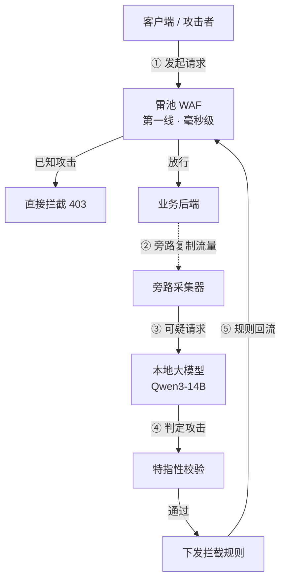
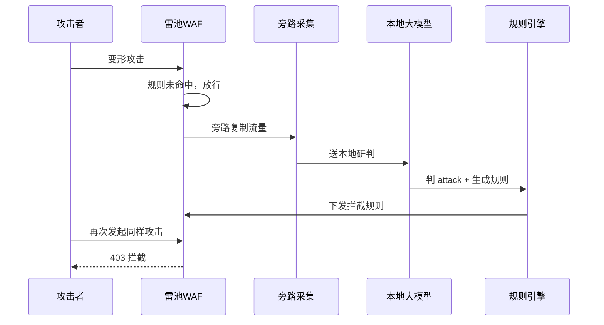

# AI-WAF 智能 Web 应用防火墙

[](LICENSE)
[](https://www.python.org/)
[](https://github.com/QwenLM/Qwen3)
[](https://waf.chaitin.cn/)
[](https://ifdian.net/a/Jenson-li)

> 🔒 **数据不出网**：流量从采集、研判到拦截，全程留在你自己的服务器，不交给任何云端。
>
> 💰 **中小企业也用得起**：开源组件 + 本地模型搭建，一次硬件投入，告别商业 WAF 每年几万块的订阅费。

一个把「本地大模型」接入开源 WAF 的**闭环防护系统**——不仅拦截已知攻击，还能**自动发现并补上规则没见过的变形攻击**。

> ⚠️ 本项目仅供合法的授权安全测试与学习研究使用。请勿用于任何未授权的攻击行为。

---

## 📖 目录

- [核心特性](#核心特性)
- [架构](#架构)
- [工作原理](#工作原理)
- [检测能力](#检测能力)
- [防误杀机制](#防误杀机制)
- [规则生命周期](#规则生命周期)
- [目录结构](#目录结构)
- [环境要求](#环境要求)
- [快速开始](#快速开始)
- [技术栈](#技术栈)
- [支持 / 赞助](#支持--赞助)

---

## 核心特性

- **本地化 / 数据不出网**：本地大模型离线推理，攻击流量与 payload 零外发，天然满足数据本地化要求
- **自动补漏（漏判检测闭环）**：旁路复盘被放行的流量，AI 认出新型攻击后自动生成拦截规则回流到 WAF
- **双层防护**：第一线雷池 WAF 毫秒级拦截已知攻击，第二层 AI 大脑异步发现漏判
- **两道防误杀保险**：规则下发前做「特指性校验」，转正前做「正常流量回放」，宁可漏判、不可误杀
- **规则全生命周期管理**：观察期 → 转正拦截 → 回收，全自动
- **可观测**：内置 Web 面板 + 终端 `trace` 工具，单步观察一次攻击从进入到被拦截的完整过程

## 架构

```
客户端/攻击者 ──①──> 雷池 WAF（第一线 · 毫秒级）
                       │ 已知攻击 ──> 403 拦截
                       │ 放行 ──> 业务后端
                                     │ ② 旁路复制流量
旁路采集器 <──────────────────────────┘
   │ ③ 可疑请求
本地大模型 Qwen3-14B
   │ ④ 判定为攻击
特指性校验（防误杀）
   │ 通过
下发拦截规则 ──⑤──> 雷池 WAF（规则回流）
```



## 工作原理

一次变形攻击（OGNL 表达式注入 `#{7*7}`，Struts2 框架经典漏洞）的完整处理过程：



关键点：**它不怕第一枪**。第一波攻击可能漏过去，但 AI 会立刻补上规则，攻击者只能打一发，后续同样的手法全部被封死。

## 检测能力

| 攻击类别 | 典型特征 |
|---|---|
| SQL 注入 | `union select`、`sleep()` 时间盲注、`information_schema` |
| XSS 跨站脚本 | `<script>`、`<svg onload>`、`javascript:` |
| 命令注入 | `\|id`、`;whoami`、`$(...)` |
| 路径穿越 | `../../etc/passwd` |
| SSRF | `169.254.169.254` 云元数据地址 |
| SSTI 模板注入 | `${...}`、`#{...}`、`{{...}}` |
| XXE / XML 注入 | `<!DOCTYPE>`、`<!ENTITY>` |
| 反序列化 | `O:8:"..."` PHP 序列化对象 |

## 防误杀机制

AI 自动生成规则最大的风险是生成"过宽泛"的规则误杀正常业务，因此内置两道保险：

1. **特指性校验**：规则下发前检查是否足够具体。像 `\bsleep\s*\(` 这种会命中"任何含 sleep 的请求"的过泛规则，直接拒绝下发。
2. **转正前回放**：规则从"观察"转"拦截"前，拿历史正常流量池回放一遍，命中任何正常请求即拒绝转正。

## 规则生命周期

```
观察期（7 天，只统计不拦截）─→ 命中达标 + 零误杀回放通过 ─→ 转正拦截
        │                                          │
        └────── 到期未达标 ──> 回收 <── 长期零命中 ──┘
```

## 目录结构

```
aiwaf/
├── main.py           # 入口：启动引擎线程 + Web 面板
├── engine.py         # 闭环引擎：轮询、研判、规则生成与生命周期维护
├── llm_client.py     # 本地 LLM 客户端（OpenAI 兼容接口 + JSON grammar）
├── safeline_api.py   # 雷池控制台 API 客户端
├── miss_collector.py # 旁路采集器（记录放行流量）
├── trace.py          # 链路追踪工具（单步观察拦截过程）
├── web.py            # Web 面板（无外部依赖的单页应用）
├── db.py             # SQLite 存储 + 规则生命周期数据层
└── config.py         # 全局配置（环境变量可覆盖）
start_*.bat           # 各组件启动脚本
AI-WAF一键恢复.bat     # 一键拉起全部组件
verify_miss_loop.py   # 漏判闭环回归脚本
miss_traffic_test.jsonl  # 测试样本
```

## 环境要求

- Windows 10/11 + **WSL2** + Docker（用于运行雷池）
- **NVIDIA 独立显卡**（建议 16GB 显存，如 RTX 5060 Ti；低配可换 4B/1.7B 模型）
- Python 3.10+（引擎侧纯标准库，无需 pip 安装额外依赖）

## 快速开始

1. **启动雷池 WAF**（WSL 内）：
   ```bash
   # 在 /data/safeline 下
   docker compose up -d
   ```

2. **启动本地大模型**（Windows）：运行 `start_llm.bat`

3. **启动旁路采集器**（WSL 内）：运行 `start_collector_wsl.sh`

4. **启动闭环引擎 + Web 面板**：运行 `start_engine.bat`

   或直接双击 `AI-WAF一键恢复.bat` 一键拉起全部组件。

启动后：

- Web 面板：`http://127.0.0.1:8899`
- 雷池控制台：`https://localhost:9443`
- 本地大模型：`http://127.0.0.1:1234`

5. **跑一次链路追踪演示**：
   ```bash
   python -m aiwaf.trace --preset ssti --verify
   ```

## 技术栈

- **WAF 引擎**：雷池 SafeLine（开源）
- **大模型**：Qwen3-14B（本地，可通过 config 切换 4B / 1.7B）
- **推理引擎**：llama.cpp（CUDA）
- **闭环引擎**：Python（纯标准库）
- **存储**：SQLite

## 免责声明

本项目为安全研究与学习用途开发。使用者须确保在**获得明确授权**的前提下进行测试，并对自身行为负责。因滥用本项目造成的任何后果，作者不承担任何责任。

## 支持 / 赞助

如果这个项目对你有帮助，欢迎通过「爱发电」赞助支持我继续开发：

👉 [在爱发电上支持我](https://ifdian.net/a/Jenson-li)

> 国内开发者暂时无法使用 GitHub Sponsors（需海外银行卡），故使用爱发电作为国内赞助渠道。

## License

[Apache License 2.0](LICENSE) © 2026 Jenson Li
